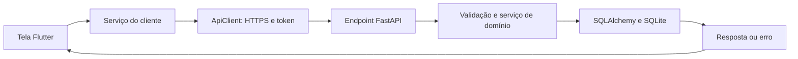

# Como a tela chega ao banco de dados

Revisão: **14/10/2026**. [Índice](README.md).

## Finalidade e caminho da operação

O cliente Flutter roda no Windows e no Android. O servidor FastAPI mantém o banco SQLite central da empresa. Os dispositivos consultam o mesmo estado; suas telas precisam ser recarregadas para mostrar alterações feitas por outro dispositivo.

A tela recolhe os dados, mostra prévias e erros. O backend revalida as regras e decide o que gravar. A interface não abre o arquivo SQLite do servidor. Alternar um controle de formulário normalmente altera apenas o preenchimento; a gravação ocorre na ação de salvar ou confirmar.

## Regras compartilhadas e banco

| Conceito | Funcionamento |
| --- | --- |
| Valores monetários | Campos comerciais em centavos inteiros; R$ 150,00 corresponde a `15000`. Custo por unidade-base pode usar microcentavos: 1 centavo = 10.000 microcentavos. |
| Quantidades | Produtos em sua unidade-base (`G`, `ML`, `UNIT`); cestas em unidades inteiras. |
| Datas | Carimbos de operações em UTC; apresentação e períodos seguem as regras de formatação do cliente e do relatório. |
| Transação | Mutações de domínio usam o bloqueio `BEGIN IMMEDIATE` do SQLite. Erro numa operação comercial provoca rollback, evitando gravar apenas parte dela. |
| Idempotência | Uma operação comercial pode enviar `X-Idempotency-Key`. O backend registra chave, operação, hash do pedido e resposta em `idempotency_records`. Repetição da mesma operação retorna a resposta; payload diferente é rejeitado. Isso não substitui as regras próprias de cada endpoint. |
| Estoque | Saldo calculado pela soma de `inventory_movements.quantity_delta`, com filtros de produto/cesta e localização. Não há um campo de saldo que a tela edita diretamente. |
| Histórico | `inventory_movements` e `cash_flow_entries` recebem novos lançamentos; os originais não são apagados ou editados. Cadastros e estados de títulos podem ser atualizados conforme suas regras. |

## Exemplo

Ao confirmar uma venda com montagem na hora, o backend valida os produtos, registra montagem, consumo e venda, apura o custo e trata o financeiro dentro da operação. Se faltar um produto, a venda não deve deixar registros parciais.

## Onde conferir

- Cliente: [ApiClient](../client/lib/core/api_client.dart) e [serviços](../client/lib/services/).
- Backend: [rotas](../backend/app/api/v1/), [serviços](../backend/app/services/) e [modelos](../backend/app/models/).
- Persistência: [database.py](../backend/app/core/database.py), [idempotency.py](../backend/app/core/idempotency.py) e [migrações](../backend/alembic/versions/).
- Convenções de interface: [layout e ações](LAYOUT_E_ACOES_DE_PAGINA.md).
